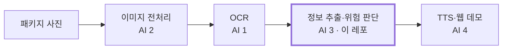

# package-info-extraction

> 딥러닝 2026-2학기 Team 05 · AI 3 (정보 추출) · 담당: 이서영

OCR이 읽은 패키지 글자에서 **제품명·소비기한·알레르기 성분**을 뽑고, 날짜를 정규화하고, 사용자 알레르기와 맞춰 **위험한 정보부터** 알려 줄 순서를 정합니다.
딥러닝 모델 없이 규칙과 사전으로 동작해서, OCR 엔진이 바뀌어도 그대로 연결할 수 있고 판단 근거를 설명하기 쉽습니다.

## 전체 시스템에서의 위치



## 폴더 구조

```
package-info-extraction/
├── extraction/       # 정보 추출 모듈 (추출·날짜 정규화·알레르기 매칭·위험 판단)
├── notebooks/        # Colab 노트북
├── data/
│   ├── samples/      # 다른 모듈이 만든 OCR 결과 샘플 (AI 2 sample_output)
│   └── labels/       # 정답 라벨 (labels.csv)
├── results/          # 평가 결과 표
├── docs/             # 모듈 간 인터페이스
├── tests/            # 테스트
└── week1/            # 1주차 결과 (카테고리·사전·로직 설계)
```

## 실행 방법

1. Colab에서 `notebooks/ai3_week3_extraction.ipynb`를 열고 **런타임 → 모두 실행**을 누릅니다. (1~2분, 2주차는 `ai3_week2_extraction.ipynb`)
2. 테스트 → AI 2 OCR 결과로 추출 → 평가(기준값별 위험 놓침률·보류율 포함) → AI 4 안내 문장까지 연결 순서로 실행됩니다.

내 컴퓨터에서는:

```
pip install -r requirements.txt
python -m pytest -q                                   # 테스트
python -m extraction data/samples/ai2_week2 --allergy 우유 땅콩    # 추출
python -m extraction.evaluate --ocr-dir data/samples/ai2_week2 --labels data/labels/labels.csv --today 2026-11-17 --sweep
python -m extraction.demo                             # 모듈 연결 확인
```

## 다른 모듈에서 쓰는 법 (AI 2·AI 4 연결용)

AI 2 `docs/interface.md` 3번에 적힌 모양 그대로입니다.

```python
from extraction import extract

result = run_pipeline(img, ocr)                # AI 2
info = extract(result["ocr"], ["우유", "땅콩"])   # AI 3

info["product_name"]          # "매운새우깡"
info["expiry"]["date"]        # "2027-04-14"
info["allergens"]["found"]    # ["밀", "새우", "대두", "우유", ...]
info["allergens"]["warning"]  # ["우유"]  ← 사용자 알레르기와 겹치는 성분
info["risk"]["level"]         # "danger"
info["priority"]              # ["allergens", "expiry", "product_name", "cautions"]
```

- 입력은 AI 1·2 OCR 결과, food-package-ocr 형식(`{"lines": [...]}`), AI 4 형식, EasyOCR·PaddleOCR 원본, 글자 문자열 무엇이든 됩니다.
- AI 4 파이프라인 형식(`extract_fields`, `assess_risk`)도 그대로 있습니다. AI_tts_web 과 같이 있으면 그 레포의 `Fields` 클래스를 그대로 써서, 결과를 AI 4 안내 문장에 바로 넣을 수 있습니다.

입출력 형식은 [`docs/interface.md`](docs/interface.md)를 참고하세요.

### 합칠 때

| 어디에 | 하는 일 | 확인 |
|---|---|---|
| food-package-ocr | `extraction/` 폴더를 그대로 복사 | `from extraction import extract` |
| AI_tts_web | 맨 위에 `extraction/` 폴더를 복사하고, AI 3 자리인 `packreader/extract/`의 `__init__.py`·`allergens.py` 두 파일만 이 모듈을 부르게 바꿈 (다른 사람 파일은 그대로. 바꿀 내용은 `tests/test_integration.py`의 `SHIM_INIT`, `SHIM_ALLERGENS`) | AI_tts_web 테스트 140개 통과, 파이프라인 안내 문장까지 동작 |

## 데이터 규칙

- `data/samples/ai2_week2/`: AI 2 레포 `results/ai2_week2/{easyocr,paddle}/sample_output/`의 JSON을 그대로 가져와 이름 앞에 엔진을 붙였습니다 (예: `paddle_p01_c0_1.json`). 뒤쪽 이름은 AI 2 규칙(`제품번호_조건ID_번호`)을 따릅니다.
- `data/labels/labels.csv`: AI 2 레포 `data/labels/labels.csv`와 같은 형식(`product_id,region,text`)입니다. 혼입 가능 성분을 재려고 `may` 줄을 더했습니다 (사진으로 확인).

| region | 내용 | 예 |
|---|---|---|
| `name` | 제품명 | 매운새우깡 |
| `allergen` | 알레르기 함유 표시 | 밀, 새우, 대두, 우유, 토마토, 게, 돼지고기, 쇠고기 함유 |
| `expiry` | 소비기한 날짜 | 2027.04.14 |
| `may` | 혼입 가능 성분 | 닭고기, 오징어, 땅콩, 계란, 잣, 조개류(굴, 전복, 홍합 포함) |

## 진행 상황

| 주차 | 기간 | 목표 | 상태 |
|---|---|---|---|
| 1주차 | 11/03 ~ 11/08 | 핵심 정보 카테고리 정의, 날짜 표기·알레르겐 사전 구축, 정보 추출 로직 설계 | 완료 ([결과](week1/README.md)) |
| 2주차 | 11/12 ~ 11/18 | 제품명·기한·알레르겐 추출, 날짜 정규화, 위험 판단 구현, 모듈 연결 | 완료 ([결과](results/ai3_week2/summary.md), [설명](extraction/README.md#2주차-추출날짜-정규화위험-판단-구현)) |
| 3주차 | 11/19 ~ 11/25 | 핵심 정보 추출 정확도 개선, 위험 판단 예외 처리, F1 평가 | 진행 중: 예외 처리·제품명 개선·기준값별 평가 완료, 팀 사진 10종 F1 평가 남음 ([결과](results/ai3_week3/summary.md), [설명](extraction/README.md#3주차-정확도-개선예외-처리평가)) |
