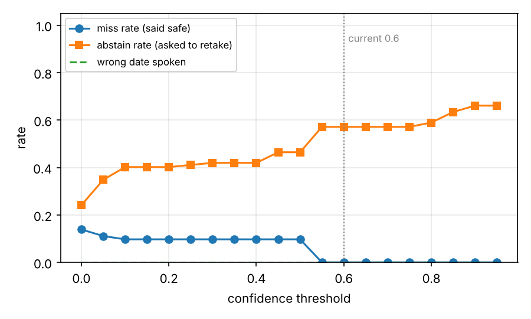

# extraction (AI 3)

OCR이 읽은 글자에서 제품명·소비기한·알레르기를 뽑고, 날짜를 정규화하고, 사용자 알레르기와 맞춰 위험도를 정합니다.

## 파일

| 파일 | 하는 일 |
|---|---|
| `api.py` | `extract()` (다른 모듈은 이것만 사용), `analyze()` |
| `fields.py` | 제품명·원재료·알레르기 함유/혼입·영양정보·주의사항 추출, `extract_fields()` (AI 4 형식) |
| `dates.py` | 날짜 찾기·정규화, 기한 종류 구분, 상대 표기 계산, 소비기한 고르기 |
| `allergens.py` | 알레르기 19종 사전, 다른 이름·파생 원재료·영어, OCR 오탈자 맞추기 |
| `risk.py` | 소비기한 상태, 내 알레르기 맞추기, 위험 판단 `assess_risk()` |
| `adapters.py` | 팀원 OCR 결과 형식을 하나로 맞추기 |
| `evaluate.py` | 저장된 OCR 결과 + 정답 라벨로 F1·위험 오분류율 계산 |
| `demo.py` | 샘플 데이터로 AI 2 → AI 3 (→ AI 4) 연결 확인 |
| `__main__.py` | 명령줄 실행 (`python -m extraction`) |
| `_deps.py`, `_standalone/` | AI_tts_web 과 같이 있으면 그 형식을, 없으면 사본을 쓰게 하는 연결부 |

실행은 Colab에서 `notebooks/ai3_week2_extraction.ipynb`를 열고 **런타임 → 모두 실행**을 누르면 됩니다.

## 사용법 (AI 2·AI 4 연결용)

```python
from extraction import extract

result = run_pipeline(img, ocr)               # AI 2
info = extract(result["ocr"], ["우유", "땅콩"])  # AI 3
info["risk"]["level"], info["priority"]      # → AI 4
```

명령줄에서도 됩니다.

```
python -m extraction data/samples/ai2_week2 --allergy 우유 땅콩 --today 2026-11-17
python -m extraction --text "소비기한 26.11.20까지\n밀, 우유 함유" --allergy 우유
```

입출력 형식은 `docs/interface.md`를 참고하세요.

## 1주차: 카테고리·사전·로직 설계

결과는 [`week1/`](../week1). 카테고리 10개와 음성 안내 우선순위, 날짜 표기 사전, 알레르기 19종 사전, 규칙 기반 추출 로직을 정했습니다.

## 2주차: 추출·날짜 정규화·위험 판단 구현

### 날짜 정규화

| 형식 | 예 | 처리 |
|---|---|---|
| 연.월.일 | 2026.11.20 / 2026-11-20 / 2026/11/20 / 2026 . 11 . 20 | |
| 한글 | 2026년 11월 20일 / 26년 11월 20일 | |
| 두 자리 연도 | 26.11.20 | 신뢰도 ×0.95 |
| 일/월/연도 | 20/11/2026, 11/20/2026 | 13 이상인 숫자로 일·월 판별. 가를 수 없으면(05/06/2027) 판단 보류 |
| 영어 월 | 20 NOV 2026, NOV 20, 2026 | 수입품 |
| 숫자만 | 20261120, 261120 | 기한 키워드가 있을 때만 (바코드·로트번호 오탐 방지) |
| 연.월 | 2026.11 | 키워드가 있을 때만. 그 달 마지막 날 |
| 상대 표기 | 제조일로부터 12개월 | 제조일자 + 12개월 − 1일 |
| OCR 오타 | 2O26.1l.2O, 소비기힌 | O→0, l→1로 고친 뒤 읽고 신뢰도 ×0.9 |

- 기한 종류: 소비기한·EXP·USE BY → 소비기한, 유통기한, 품질유지기한·BEST BEFORE, 제조일자·MFD는 후보에서 뺌
- '후면표기일까지'·'별도표기' 문구와 따로 찍힌 날짜가 같이 있으면 그 날짜를 소비기한으로 봄 (매운새우깡 실제 포장)
- 날짜 뒤에 '까지'가 붙으면 키워드가 없어도 소비기한으로 봄

### 알레르기 매칭

| 단계 | 예 | 쓰는 곳 |
|---|---|---|
| 표준·다른 이름 | 계란→알류, 소고기→쇠고기, 홍합→조개류, milk→우유 | 어디서나 |
| 조사·마지막 글자 오인식 | 새우를→새우, 새우틀→새우 | 어디서나 |
| 파생 원재료 | 두유→대두, 원유→우유, 마요네즈→알류, 소맥분→밀, 쉬림프→새우 | 표시란, 원재료명 |
| 붙어 읽힌 이름 | 밀새우→밀, 새우 | 표시란 |
| OCR 오탈자 (자모 거리) | 유유→우유, 토미토→토마토, 돼지고→돼지고기, 홍한→조개류 | 표시란·혼입 문구만, 신뢰도 ×0.8 |

- 함유: '○○ 함유' 줄, '함유'만 따로 읽힌 줄(위 줄을 봄), 기울어져 '함유 ○○'로 읽힌 줄, '알레르기 유발물질: ○○', 성분만 4개 이상 나열된 줄, 원재료명 속 성분
- 혼입 가능: '○○를 사용한 제품과 같은 (제조)시설', '혼입될 수 있습니다', '같은 시설에서 ○○를 사용한 제품을', 'may contain'. '이 제품은' 없이 '·'로 시작하거나 두 줄에 걸쳐도 처리
- 오탐 방지: 한 글자 이름(밀·게·잣)은 토큰이 정확히 같을 때만. '밀폐', '하게', '카페인 함유'는 잡지 않음
- 표 형태 포장: '제품명'·'원재료명' 칸 이름이 따로 읽히면 박스 좌표로 오른쪽 칸을 찾음

### 실제 사진 결과

AI 2가 찍은 매운새우깡 사진 8장의 OCR 결과(EasyOCR 5장, PaddleOCR 3장)로 평가했습니다. 정답은 AI 2 `labels.csv`에 사진으로 확인한 혼입 성분을 더했습니다. 전체 결과는 [`results/ai3_week2/`](../results/ai3_week2).

| 지표 | 1주차 코드 | 2주차 |
|---|---|---|
| 알레르기 함유 F1 (Precision / Recall) | 0.67 (0.88 / 0.55) | **0.75** (1.00 / 0.59) |
| 혼입 가능 F1 | 0.00 | **0.72** (1.00 / 0.56) |
| 소비기한 날짜 정확도 | 0.25 | **0.875** |
| 틀린 날짜를 말한 비율 | 0 | 0 |
| 없는 성분을 함유라고 말함 | 5건 | **0건** |
| 제품명 완전 일치 | 0 / 8 | 1 / 8 |

- PaddleOCR 정상(c0)·회전(c6) 사진은 함유 8종·혼입 6종·소비기한을 모두 맞혔습니다.
- 놓친 것은 대부분 OCR 이 글자를 거의 못 읽은 어두운 사진(c1)·원거리(c5)입니다. 이때는 "알레르기 표시를 찾지 못했어요"로 안내되고, 일부만 읽고 나머지를 조용히 놓친 비율은 0.16입니다 (EasyOCR 이 '쇠고기'를 '죄끼'로 읽은 경우 등).
- 제품명: 표에 '제품명' 칸이 읽히지 않으면 가장 큰 글씨를 고르는데, 실제 사진에서는 브랜드 로고(농심)가 잡힙니다.

## 3주차: 정확도 개선·예외 처리·평가

목표는 핵심 정보 추출 정확도 개선, 위험 판단 예외 처리, F1 평가입니다. 결과는 [`results/ai3_week3/`](../results/ai3_week3).

### 위험 판단 예외 처리

| 경우 | 처리 | 위험 판단 |
|---|---|---|
| 글자를 거의 못 읽은 사진 (신뢰도 0.3 이상인 글자가 없음) | 아무것도 단정하지 않음 | `text_unreadable` → 확인 필요 |
| 같은 종류 기한이 서로 다른 날짜로 읽힘 (소비기한 12.01 / 12.07) | 하나를 잘못 읽었을 수 있어 날짜를 말하지 않음 | `expiry_unknown` → 확인 필요 |
| 알레르기 목록이 쉼표·괄호로 끝남 (사진 밖으로 잘림) | 보이는 성분은 그대로, 신뢰도 ×0.5 | 내 성분이 안 보이면 `allergen_uncertain` → 확인 필요 |
| 알레르기 표시가 흐림 (신뢰도 0.6 미만) | | 내 성분이 안 보이면 `allergen_uncertain` → 확인 필요 |
| 수입품 영어 표시 `Contains: milk, soy. May contain peanuts.` | 함유·혼입을 나눠서 읽음 | |
| 냉장 우유류 유통기한 (2031년까지 유통기한 표기) | 유통기한으로 판단 | |

### 제품명 개선

- 브랜드 이름(농심, 오뚜기, 롯데 등 70개)과 OCR 이 한 글자 더 붙여 읽은 브랜드('농심물')는 제품명 후보에서 뺍니다.
- 광고 문구('…만들어요'), 영양정보 조각, 주소, 'QR 바로가기' 같은 글자를 뺍니다.
- 가장 큰 한글 글씨의 60%보다 작은 글자는 제품명으로 추측하지 않습니다 (설명 문구일 가능성이 큼).
- '제l명', '제품생'처럼 OCR 이 잘못 읽은 '제품명' 칸도 찾습니다.

| 지표 (매운새우깡 8장) | 2주차 | 3주차 |
|---|---|---|
| 엉뚱한 제품명을 말함 (글자 절반 이상 틀림) | 5 / 8 ('농심' 3번 등) | **0 / 8** |
| 제품명을 말하지 않음 | 0 / 8 | 4 / 8 (EasyOCR 이 제품명 글자를 못 읽은 사진) |

### 기준값별 위험 놓침률·보류율

`python -m extraction.evaluate … --sweep` 로 판단 보류 기준값(0~0.95)을 바꿔 가며 잽니다. 위험한 경우는 '정답 기한 다음 날 → 지났다고 말하는가'와 '정답 함유 성분을 내 알레르기로 등록 → 들어 있다고 말하는가'이고, 안전한 경우는 '들어 있지 않은 성분을 등록 → 경고하지 않는가'입니다.



| 기준값 | 위험 놓침률 | 보류율 | 틀린 날짜를 말함 | 헛경보 |
|---|---|---|---|---|
| 0.0 | 0.139 | 0.241 | 0 | 0 |
| 0.5 | 0.097 | 0.464 | 0 | 0 |
| **0.6 (현재)** | **0** | 0.571 | 0 | 0 |
| 0.9 | 0 | 0.661 | 0 | 0 |

- 0.55 이상에서 위험 놓침이 0이 됩니다. 현재 기준값 0.6은 놓침 0을 지키는 가장 낮은 쪽이라 유지합니다.
- 보류율은 OCR 신뢰도에 따라 크게 달라집니다 (기준값 0.6에서 EasyOCR 사진 0.67, PaddleOCR 사진 0.40). OCR 이 좋아지면 같이 내려갑니다.
- 아직 제품 1종이라 팀 사진 10종이 나오면 같은 명령으로 다시 재서 기준값을 정합니다.

### 남은 일

- [ ] 팀 사진 10종의 OCR 결과 + 제품 단위 정답(`data/labels/labels.csv` 형식)으로 F1·위험 놓침률·보류율 다시 측정
- [ ] 측정에서 많이 틀린 것부터 정확도 개선

